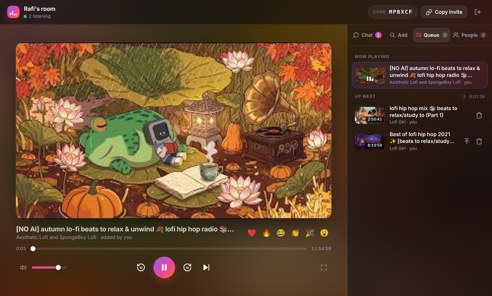
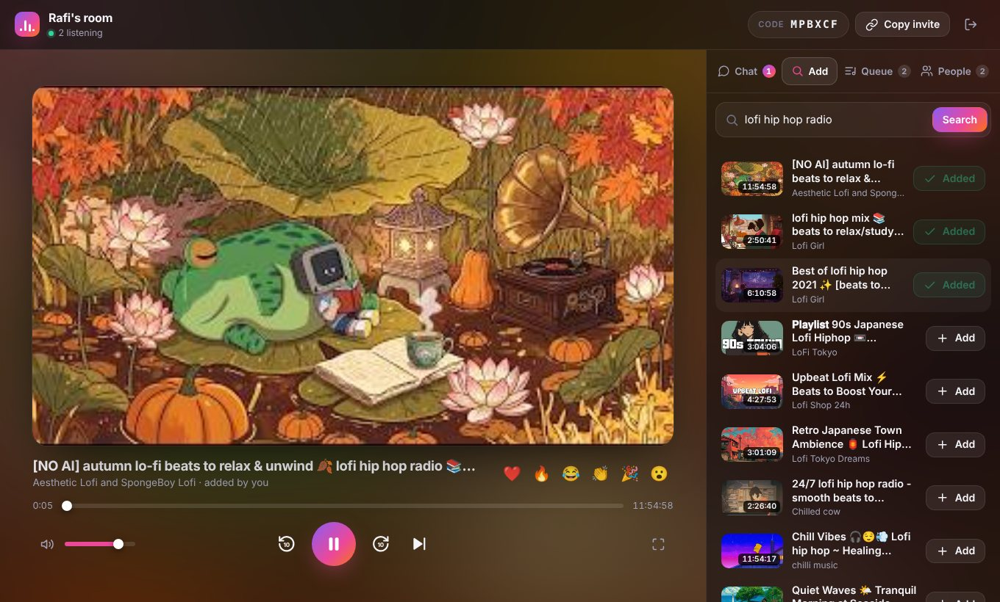
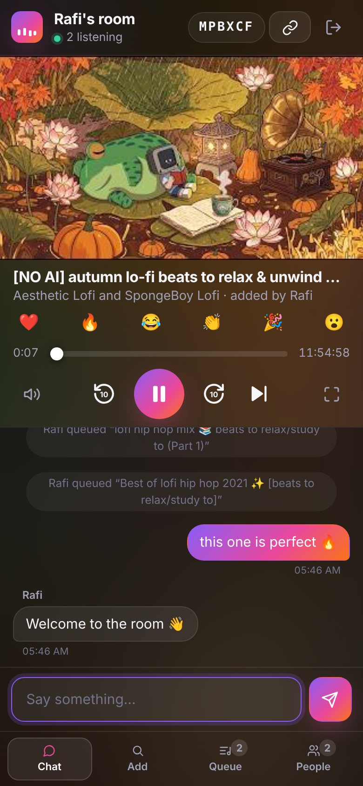

<div align="center">

# Music Space

**Listen to YouTube music in perfect sync with friends.**
Create a room, share the link, queue songs, chat and react together — no sign-up.

[](https://github.com/TMAn1An/Shared-Music-Space/actions/workflows/ci.yml)
[](LICENSE)




</div>

<table>
  <tr>
    <td width="62%"></td>
    <td width="38%"></td>
  </tr>
</table>

## Contents

- [Features](#features) · [Quick start](#quick-start) · [Two ways to run it](#two-ways-to-run-it)
- [Documentation](#documentation) · [Project layout](#project-layout) · [Contributing](#contributing) · [Legal](#legal-note)

## Features

- **Everyone hears the same beat.** The room owns one playback clock; play, pause, seek and skip are the same for all, and late joiners and reconnects land on the exact second.
- **Easy to start.** A fun nickname is pre-filled, join with a code *or a pasted invite link* (`/r/ABC123`), one-tap "Invite friends", and a reload or network drop puts you back in your seat.
- **Queue like a party.** Search YouTube or paste a link; add, "play next", remove, and see what played recently. Unplayable videos are skipped automatically.
- **Social.** Live chat with history, floating emoji reactions, a host crown that moves on when the host leaves.
- **Feels native.** Responsive split view on desktop, thumb-friendly tabs on phones, keyboard shortcuts (`Space` play/pause · `←/→` ±10 s · `M` mute · `F` fullscreen), media-key and lock-screen controls, installable as an app, screen stays awake while playing.
- **Accessible.** Keyboard focus styles, labelled controls, reduced-motion support.
- **Safe by design.** All user text is rendered with DOM APIs (no `innerHTML`), identity comes from the connection or a signed key, never from a client-supplied name.

## Quick start

You need the [.NET 8 SDK](https://dotnet.microsoft.com/download) — nothing else (the frontend has no build step).

```bash
git clone https://github.com/TMAn1An/Shared-Music-Space.git
cd Shared-Music-Space
dotnet run --project SharedMusicSpace      # open http://localhost:5271
```

Open it in two browser windows, create a room in one and join from the other with the code or invite link.

```bash
dotnet test                                # server room logic (14 tests)
node --test tests-js/*.test.mjs            # serverless engine (17 tests, Node 22+)
docker build -t music-space . && docker run -p 8080:8080 music-space
```

## Two ways to run it

| | **Server mode** | **Serverless mode** (peer-to-peer) |
|---|---|---|
| Needs a backend | ASP.NET Core + SignalR | **No** — static files only (Vercel, Netlify, GitHub Pages…) |
| Room lives in | the server's memory | the **host's browser** |
| If the host leaves | room is unaffected | the next member takes over automatically |
| Search | works out of the box | paste a link, or add your own free YouTube API key |
| Room size | large | small groups (≤ 12) |
| Cost | a small always-on server | free |

The app chooses by itself: if a backend answers at `/healthz` (or `config.js` names one) it uses server mode, otherwise it runs serverless. Force one with `window.MUSIC_SPACE_MODE = 'server' | 'p2p'` in `config.js`. Add `?p2p=local` to the URL to try serverless mode between tabs of one browser with no network at all.

Serverless mode uses WebRTC for transport, a **hash-chained event log** so peers can detect tampered history, and **signed commands** so nobody can act in someone else's name. See [docs/ARCHITECTURE.md](docs/ARCHITECTURE.md).

## Documentation

| Guide | What's inside |
|---|---|
| [docs/DEPLOYMENT.md](docs/DEPLOYMENT.md) | Step-by-step: static-only (Vercel), single Docker host, split frontend + backend (Vercel + Render) |
| [docs/CONFIGURATION.md](docs/CONFIGURATION.md) | Every environment variable and `config.js` option |
| [docs/ARCHITECTURE.md](docs/ARCHITECTURE.md) | How sync, rooms, the hub API, the P2P protocol and failover work |
| [docs/TROUBLESHOOTING.md](docs/TROUBLESHOOTING.md) | "Can't connect", no sound, search not working, and other common problems |
| [CONTRIBUTING.md](CONTRIBUTING.md) · [SECURITY.md](SECURITY.md) · [CHANGELOG.md](CHANGELOG.md) | Dev setup and conventions, reporting vulnerabilities, release notes |

## Project layout

```
SharedMusicSpace/
  Domain/            Room.cs — all room state and rules (thread-safe, unit-tested)
  Services/          RoomService (registry), YouTubeService (search + metadata with fallbacks), RoomSweeper
  Hubs/MusicHub.cs   SignalR API; identity comes from the connection
  wwwroot/
    index.html, css/ The UI (hand-written design system, no framework)
    js/main.js       UI logic;  player.js  YouTube player locked to the room clock
    js/core/         Serverless engine: room rules, hash chain, identity (ECDSA)
    js/p2p/          Serverless engine: protocol, transports, search, metadata
    vendor/          SignalR client, Trystero (both MIT)
SharedMusicSpace.Tests/   xUnit tests for the server rules
tests-js/                 Node tests for the serverless engine
deploy/render.yaml        Render blueprint for the backend
```

## Contributing

Bug reports, ideas and pull requests are welcome — start with [CONTRIBUTING.md](CONTRIBUTING.md). Please report security problems privately as described in [SECURITY.md](SECURITY.md).

## Legal note

Playback uses YouTube's official embedded player; Music Space does not download or re-host any media. In server mode, search and metadata use [YoutubeExplode](https://github.com/Tyrrrz/YoutubeExplode), which scrapes YouTube and can break or be rate-limited at any time (the app falls back to oEmbed for titles). Check YouTube's terms before running a public instance. Licensed under the [MIT License](LICENSE); third-party components are listed in [THIRD_PARTY_NOTICES.md](THIRD_PARTY_NOTICES.md).
